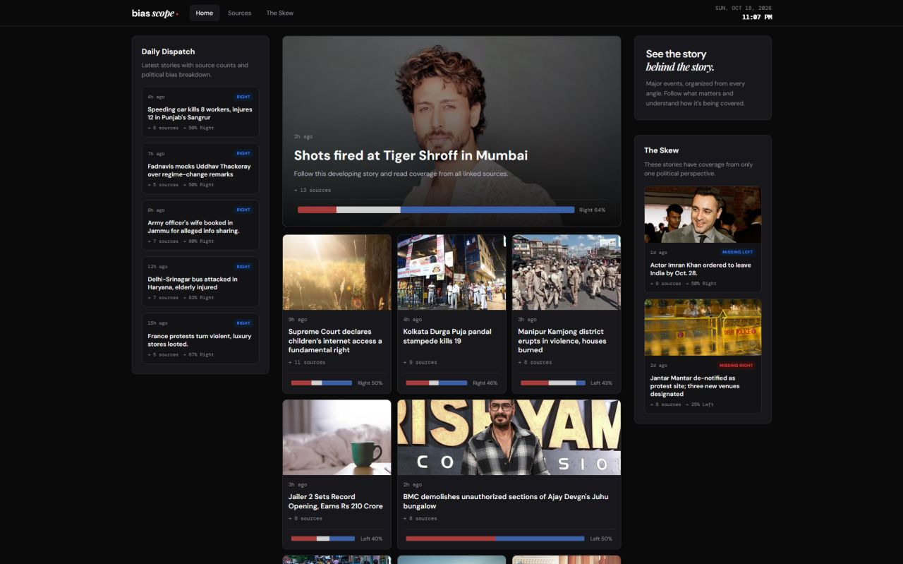
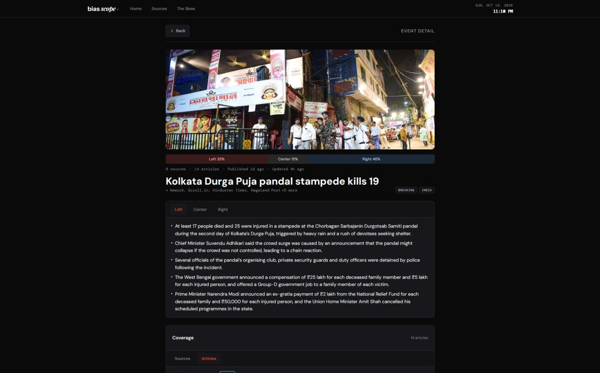

# BiasScope

**"There are no facts, only interpretations."**

The same event can read very differently depending on where you read it. BiasScope collects articles from 50+ Indian news outlets, works out which ones are about the same story, and shows how coverage splits across the political spectrum, with a separate summary for each side.




## The idea

Most news aggregators show you a feed of headlines. That makes it hard to notice two things:

1. **Many headlines are the same story.** Forty articles may all describe one event.
2. **Who covers a story, and how, says something.** A story that only one side of the spectrum reports is itself a signal.

BiasScope tackles both. It turns a pile of articles into a list of *events*, then lets you see each event through the lens of who covered it.

## What you see

- **Events, not headlines.** Each event is a cluster of articles about the same story, with a single neutral headline.
- **A bias breakdown.** Every event shows what share of its coverage came from left-leaning, centrist, and right-leaning outlets.
- **Three summaries per event.** Each political division gets its own short summary (4–6 bullets) of how it covered the story.
- **The Skew.** A view of stories covered by only one side, which are easy to miss in a normal feed.
- **Key claims.** Claims that show up across several outlets, with counts of how many outlets and sources made them.
- **Source pages.** Every outlet has a page listing its coverage and article count.

## How it works

BiasScope is a pipeline of four independent stages. Each one can run on its own and hands its results to the next through the database.

```
RSS feeds ─▶ 1. Fetch ─▶ 2. Cluster ─▶ 3. Summarize ─▶ 4. Analyze claims
                                │              │                │
                                └──────────────┴────────────────┴──▶ Database ─▶ Web app
```

### 1. Fetch: collect and clean the articles

The pipeline reads RSS feeds from 50+ outlets. For each entry it cleans up the title, drops boilerplate, and extracts the full article text from the page, so later stages work with the actual story rather than just a headline.

### 2. Cluster: turn articles into events

Each article title is converted into an embedding, a vector that captures what the title means. Two articles are considered close when they are similar in meaning *and* published near each other in time. The blend is weighted heavily toward meaning:

> similarity = 0.9 × semantic similarity + 0.1 × temporal similarity

Articles are then grouped with **HDBSCAN**, a density-based clustering algorithm. It suits this problem because it doesn't need to know the number of events in advance and can leave one-off articles unclustered instead of forcing them into a group. Each resulting cluster becomes an event, and an LLM writes a neutral headline for it.

### 3. Summarize: one summary per side

An event's articles are split by each outlet's political leaning, then a single LLM call writes 4–6 bullets for each division. Because each side is summarized from its own articles only, one side's framing doesn't leak into another's.

### 4. Analyze: find the claims

Within an event, candidate sentences are clustered to find statements that appear in more than one place. An LLM then checks that they really are claims and merges equivalent ones into a single canonical claim. The app can then show how many outlets and sources repeat each claim.

## How bias is measured

Bias in BiasScope is a property of the **outlet**, not of individual articles. Every outlet has a score on a left-to-right scale, and an article inherits the score of the outlet that published it.

| Score | Classification |
|---|---|
| `≤ -3.5` | Left |
| `> -3.5` and `< 3.5` | Center |
| `≥ 3.5` | Right |
| `-69` | Unrated |

An event's left / center / right percentages are computed from the articles it contains. Unrated outlets are left out of the calculation, so they don't dilute the split.

## What to keep in mind

- **Scores are editorial judgements.** They are set by hand and are not inferred from what an article says. A left-leaning outlet can publish a balanced piece, and the score won't reflect that.
- **LLM output can be wrong.** Headlines, summaries, and claims are machine-generated. Treat them as a way into the articles, not a replacement for them.
- **Clustering is statistical.** Occasionally unrelated articles are grouped together or related ones are missed.
- **Coverage depends on the feeds.** The picture is limited to the 50+ outlets tracked and what their RSS feeds expose.

## Built with

Python (`feedparser`, `trafilatura`, `sentence-transformers`, `hdbscan`, scikit-learn), an LLM (`openai/gpt-oss-20b`), Supabase (Postgres), and a React + Vite frontend.

## License

Not specified yet. Add a `LICENSE` file before making this repository public.